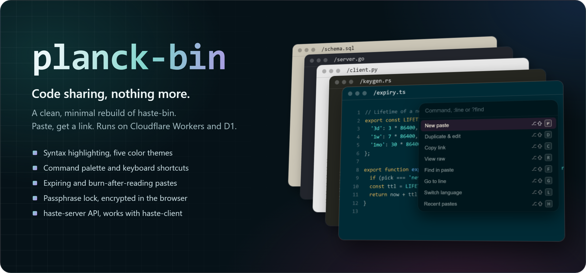

# planck-bin

Pastebin for Cloudflare Workers with D1 storage. API compatible with haste-server.

[Demo](https://planck-bin.sigman78.workers.dev/)

[](https://deploy.workers.cloudflare.com/?url=https://github.com/sigman78/planck-bin)

<p align="center"></p>

## Features

- Runs on Workers, stores pastes in D1. Fits the free tier for personal use.
- Command palette and keyboard shortcuts for all actions.
- Same HTTP API as haste-server, so [haste-client](https://github.com/seejohnrun/haste-client) works.
- Per-paste lifetime (3 days to permanent) and burn after reading.
- Passphrase-protected pastes, encrypted in the browser.
- Rendered preview for markdown pastes.
- Five color themes.
- Optional sign-in through any OpenID Connect provider, with private pastes and a list of your own.

## Background

Based on [haste-server](https://github.com/seejohnrun/haste-server) by John Crepezzi. The original
uses Node.js and Redis; this version is rewritten in TypeScript with Vite and runs on Cloudflare.

## Quick start

```bash
pnpm install
pnpm db:migrate:local
pnpm dev          # http://localhost:8787
```

## Deploy

```bash
pnpm exec wrangler d1 create haste-db   # copy the database_id into wrangler.toml
pnpm db:migrate:remote
pnpm run deploy
```

Settings, upgrades and limits: [docs/configuration.md](docs/configuration.md). Sign-in setup:
[docs/sign-in.md](docs/sign-in.md).

## Command palette


Press **Ctrl+/** (or click the pill in the top-right corner) to open the command palette. Type to
filter commands, then press Enter. Each command shows its keyboard shortcut.

| Query   | Does                                                |
| ------- | --------------------------------------------------- |
| `save`  | Fuzzy-filter commands (save, new, copy link, ...)   |
| `:42`   | Go to line 42                                       |
| `?text` | Find text in the paste; Enter / Shift+Enter to step |

## API

```bash
curl -X POST https://your-worker.dev/documents -H "Content-Type: text/plain" -d "code here"
curl https://your-worker.dev/raw/KEY
```

Full reference: [docs/api.md](docs/api.md).

## Tests

```bash
pnpm test          # unit tests (jest)
pnpm test:e2e      # browser tests (playwright)
pnpm test:api      # API integration tests (needs `pnpm dev` running)
```

## License

MIT, see [LICENSE](LICENSE). Inspired by Haste-bin [John Crepezzi](https://github.com/seejohnrun).
