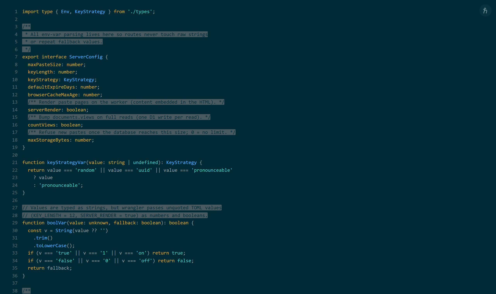
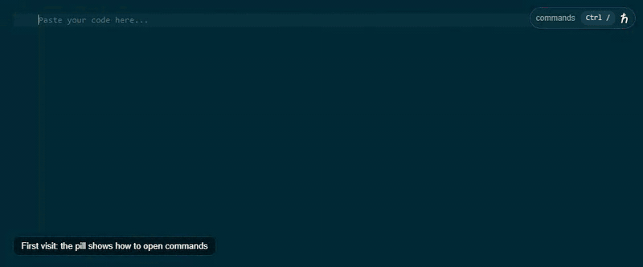

# planck-bin

Pastebin for Cloudflare Workers with D1 storage. API compatible with haste-server.

[Demo](https://planck-bin.sigman78.workers.dev/)

[](https://deploy.workers.cloudflare.com/?url=https://github.com/sigman78/planck-bin)



## Features

- Runs on Workers, stores pastes in D1. Fits the free tier for personal use.
- Optional server-side rendering of paste pages.
- Command palette (Ctrl+/) and keyboard shortcuts for all actions.
- Same HTTP API as haste-server, so [haste-client](https://github.com/seejohnrun/haste-client) works.
- Per-paste lifetime (3 days to permanent) and burn after reading.
- Passphrase-protected pastes, encrypted in the browser.
- Paste expiry with a nightly cleanup cron, rate limits, optional storage cap.
- Local drafts and recent paste list in the browser.

## Background

Based on [haste-server](https://github.com/seejohnrun/haste-server) by John Crepezzi. The original
uses Node.js and Redis; this version is rewritten in TypeScript with Vite and runs on Cloudflare.

## Quick start

```bash
pnpm install
pnpm db:migrate:local
pnpm dev          # http://localhost:8787
```

## Deploy

```bash
pnpm exec wrangler d1 create haste-db   # copy the database_id into wrangler.toml
pnpm db:migrate:remote
pnpm run deploy   # "pnpm deploy" is a built-in pnpm command
```

When upgrading, apply new migrations (`pnpm db:migrate:remote`) before deploying the worker: the
code reads columns that older databases do not have yet.

Your instance will be live at `https://planck-bin.YOUR-SUBDOMAIN.workers.dev`.

## Config

Edit `wrangler.toml` vars:

| Variable                | Default       | Description                                                    |
| ----------------------- | ------------- | -------------------------------------------------------------- |
| `MAX_PASTE_SIZE`        | 400000        | Max paste size in bytes                                        |
| `KEY_LENGTH`            | 10            | Length of paste IDs                                            |
| `KEY_STRATEGY`          | pronounceable | Paste ID format: `pronounceable`, URL-safe `random`, or `uuid` |
| `DEFAULT_EXPIRE_DAYS`   | 30            | Days until expiration when the client picks no lifetime        |
| `MAX_EXPIRE_DAYS`       | 0             | Cap on any lifetime, including permanent; 0 = no cap           |
| `BROWSER_CACHE_MAX_AGE` | 0             | Browser cache for API reads, seconds, capped at paste expiry   |
| `SERVER_RENDER`         | false         | Render paste pages on the worker (see below)                   |
| `COUNT_VIEWS`           | false         | Count paste views in D1 (costs one database write per read)    |
| `MAX_STORAGE_MB`        | 0             | Refuse new pastes (`507`) once the database is this big; 0 off |

`KEY_LENGTH` applies to `pronounceable` and `random` IDs. Random IDs carry six bits of
entropy per character; UUID IDs use `crypto.randomUUID()` and ignore `KEY_LENGTH`.
Creation and read limits are configured by the two `ratelimits` bindings in `wrangler.toml`.

Numeric settings are clamped to safe ranges: `MAX_PASTE_SIZE` 1 to 1,900,000 (under D1's 2 MB row
limit), `KEY_LENGTH` 6 to 48, `DEFAULT_EXPIRE_DAYS` and `MAX_EXPIRE_DAYS` 0 to 36,500, and
`BROWSER_CACHE_MAX_AGE` 0 to one year. A value that is not a plain integer falls back to the default.

`MAX_STORAGE_MB` is a coarse safety valve, not a quota. Keep these limits in mind:

- It compares the D1 database file size (`meta.size_after`), not the space live rows use. Space
  freed by deleting expired pastes only counts once the file shrinks. Production D1 reclaims it,
  but a local `wrangler dev` database may not, so the budget can stay "full" after cleanup.
- It is global. One client at the creation rate limit (30/min of up to `MAX_PASTE_SIZE` each,
  roughly 12 MB/min at the default) can fill a small budget in minutes. Then every user gets
  `507` until the cleanup cron deletes enough expired pastes, which with the default 30-day
  expiry can take weeks. Size the budget well above the expected churn, or pair it with a
  shorter `DEFAULT_EXPIRE_DAYS`. Permanent pastes never free space; set `MAX_EXPIRE_DAYS` on a
  public instance to keep every paste expiring.
- `507` is a WebDAV status, so generic haste clients will show it as an unknown error.

With `SERVER_RENDER` on, a paste URL (`/key` or `/key.ext`) comes back with the paste already in
the page: the text is visible at first paint and the client skips the `/documents` fetch. The
worker does not highlight; the URL extension still picks the language in the browser. A paste
that does not exist gets a `404` page the client recognizes, so it shows "not found" without a
second lookup. Any other failure (rate limit, storage error, a paste over 128 KB) serves the plain
page, which is exactly the client-rendered path you get with the flag off.

## API

```bash
curl -X POST https://your-worker.dev/documents -H "Content-Type: text/plain" -d "code here"
curl https://your-worker.dev/documents/KEY
curl https://your-worker.dev/raw/KEY
curl --data-binary @secret.txt "https://your-worker.dev/documents?expires=3d&burn=1"
```

- `POST /documents` takes `text/plain` or JSON `{"content": "..."}` and returns
  `201 {"key", "expiresAt"}`; `413` when over `MAX_PASTE_SIZE`, `507` when the database has
  reached `MAX_STORAGE_MB`. Optional query parameters:
  - `expires=3d|1w|1mo|6mo|never`: lifetime (default `DEFAULT_EXPIRE_DAYS`, capped by
    `MAX_EXPIRE_DAYS`). Other values return `400`.
  - `burn=1`: burn after reading. The response then carries `"burn": true`.
- `GET /documents/KEY` returns `{"key", "content", "createdAt", "expiresAt"}` (ISO 8601, `null`
  for none) with an `ETag`; `If-None-Match` gets `304`.
- `GET /raw/KEY` returns the text as `text/plain`.
- Expired pastes return `404` on both, even before the cleanup cron removes them.
- A burn-after-reading paste is deleted by its first `GET` on `/documents/KEY` or `/raw/KEY`
  (one atomic `DELETE ... RETURNING`, so two readers never both get it). That response has
  `"burn": true` and `Cache-Control: no-store`; later reads are `404`. `HEAD` and
  `GET /documents/KEY?peek=1` do not consume it: the latter returns `{"key", "burnPending": true}`
  without content. The page URL (`/KEY`) never reads it either: the palette pill turns into an
  "Open and burn" question, and only that answer reads it, so link previews and prefetchers
  cannot burn it. If that read fails (offline, server error), the paste is left intact.
- A protected paste is created with a JSON body `{"content", "lock": {"salt", "token"}}`:
  `content` is already encrypted, `salt` (16 bytes) and `token` (32 bytes) are base64url. The
  response carries `"locked": true`. The server stores the ciphertext, the salt and SHA-256 of the
  token. `GET /documents/KEY` returns `{"key", "locked": true, "salt"}` (plus `"burn": true` for a
  burn paste) without content, `GET /raw/KEY` returns `403`, and the page URL embeds only that
  marker.
- `POST /documents/KEY/unlock` with `{"token"}` returns the stored document (still encrypted) for
  the right token: `403 {"message", "attemptsLeft"}` for a wrong one, `410` for the tenth wrong
  one, which deletes the paste. Attempts are counted before they are checked, so concurrent
  guesses cannot exceed the cap; a right token is not counted. A protected burn paste is deleted
  by its unlock, not by `GET`. Unlocks spend a read rate-limit token.
- Built-in pages such as `about` work on both and carry `"frozen": true`.
- Other methods on these routes return `405` with an `Allow` header.

## Command palette



Press **Ctrl+/** (or click the h-bar pill in the top-right corner) to open the command
palette. Type to filter commands, then press Enter.

| Query   | Does                                                |
| ------- | --------------------------------------------------- |
| `save`  | Fuzzy-filter commands (save, new, copy link, ...)   |
| `:42`   | Go to line 42                                       |
| `?text` | Find text in the paste; Enter / Shift+Enter to step |

It also switches the highlighting language and lists recent pastes kept in this browser. While
editing, **Expires** picks the lifetime of new pastes (remembered in this browser) and **Burn
after reading** makes the next save a one-time paste (picked again, it reads **Don't burn after
reading** and turns it off). Non-default choices show as an icon on
the Save chip: a clock for a lifetime, a flame for burn (the flame wins when both are set); the
details are in its tooltip. Burn pastes are not added to the recent list.

**Protect with passphrase** makes the next save a protected paste. It proposes a generated
passphrase, four words from the [EFF long wordlist](https://www.eff.org/dice) (about 52 bits),
in an editable field: Enter accepts it, or type your own (at least 8 characters; a note appears
when an edit makes it shorter than three words or 16 characters). The Save chip then shows a
lock; running the command again turns protection off. After saving, the passphrase is shown once
as it was set, with a copy button. Opening the link asks for it; case and the separators between
words (spaces, dashes, dots) do not matter. **Copy passphrase** stays available in the tab that
created the paste. Protected pastes appear in the recent list as
"Protected paste", without their text.

How it works: the browser derives a key from the passphrase with PBKDF2-SHA256 (600,000
iterations, random salt) and splits it with HKDF into an AES-256-GCM content key and an unlock
token. Only the ciphertext, the salt and a hash of the token reach the server, which releases
the ciphertext only for the right token and deletes the paste after 10 wrong passphrases. A
stolen database still needs an offline search through PBKDF2 per guess. The server also serves
the page's JavaScript, so this protects against database leaks and passive operators, not
against a modified deployment.

Printing (the browser's Print) produces a plain black-and-white source listing: numbered lines,
long lines wrapped under their own number, and the paste address, line count and page numbers in
the page margins.

## Shortcuts

| Action            | Windows / Linux     | Mac                 |
| ----------------- | ------------------- | ------------------- |
| Command palette   | Ctrl+/              | Ctrl+/              |
| Save              | Ctrl+S / Ctrl+Enter | Cmd+S / Cmd+Enter   |
| New paste         | Alt+Shift+P         | Opt+Shift+P         |
| Duplicate & edit  | Alt+Shift+D         | Opt+Shift+D         |
| Copy link         | Alt+Shift+C         | Opt+Shift+C         |
| View raw          | Alt+Shift+R         | Opt+Shift+R         |
| Find in paste     | Alt+Shift+F         | Opt+Shift+F         |
| Go to line        | Alt+Shift+G         | Opt+Shift+G         |
| Switch language   | Alt+Shift+L         | Opt+Shift+L         |
| Recent pastes     | Alt+Shift+H         | Opt+Shift+H         |
| Zoom in/out/reset | Alt+Shift+= / - / 0 | Opt+Shift+= / - / 0 |
| Share on X        | Alt+Shift+X         | Opt+Shift+X         |

Alt+Shift (Opt+Shift on Mac) is the same physical chord everywhere and is left alone by
browsers, except Chrome's Alt+Shift+I/A/N/T, which are not used. Keys match the physical key,
so they work on any layout, and a key only does something while its command is available.

## Tests

```bash
pnpm test          # unit tests (jest)
pnpm test:e2e      # browser tests (playwright)
pnpm test:api      # API integration tests (needs `pnpm dev` running)
pnpm screenshots   # regenerate the README screenshot in docs/media
```

## License

MIT, see [LICENSE](LICENSE). Based on the original Haste by [John Crepezzi](https://github.com/seejohnrun).
